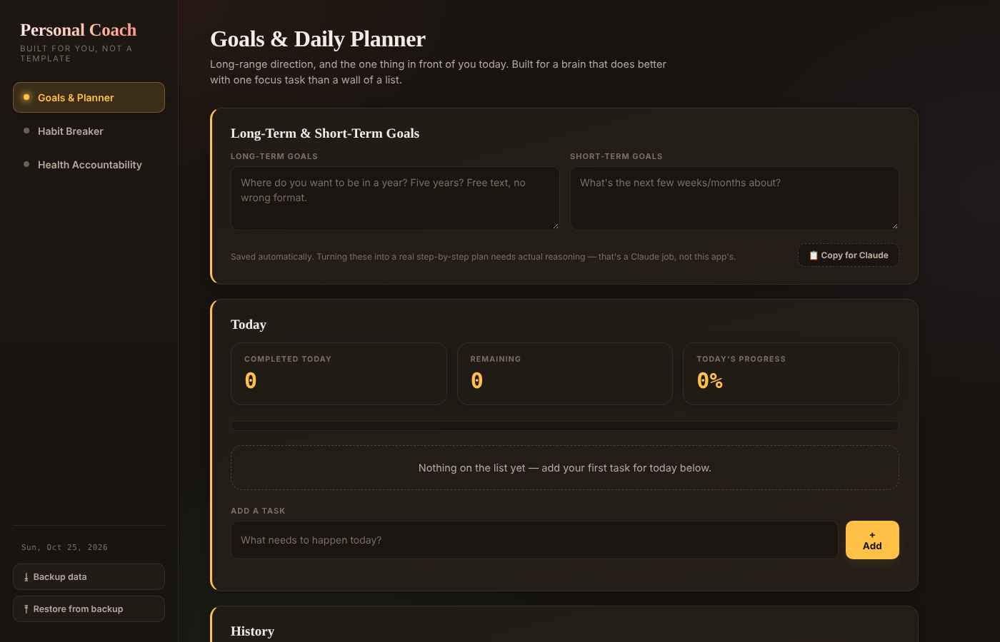

# 🎯 Personal Coach

**Live demo:** https://jaxzader.github.io/personal-coach/

A browser-based productivity and habit app built around one idea: show **one focus task at a time** instead of a wall of to-dos, and track progress with streaks.

## What it does

| Section | What it does |
|---|---|
| **Goals & Daily Planner** | Long- and short-term goals, plus a daily task list that surfaces one "focus" task at a time. Tasks can be broken into sub-steps, with progress stats and history. |
| **Habit Breaker** | Track habits you want to break with streaks. Each habit links to a built-in reference library of evidence-based techniques (if-then planning, habit-loop disruption, friction design) and its physical, mental, financial, and relational effects. |
| **Health Accountability** | A custom daily checklist (water, exercise, sleep, etc.) with per-item and full-day streaks. |

## Design choices

- **App organizes, AI reasons.** The app tracks and stores; it doesn't pretend to give advice. The goals and habit sections have a **"Copy for Claude"** button that exports your data as a clean prompt, so an LLM can do the deeper planning.
- **Private by default.** Everything is saved in the browser's local storage. Nothing is sent to a server. Backup and restore use a JSON file.
- **Built for focus.** One focus task, small wins, and quick celebration feedback to make starting easier.
- **No frameworks.** Plain HTML, CSS, and JavaScript, so it runs by opening one file.

## Tech

HTML · CSS · JavaScript · localStorage

| File | Purpose |
|---|---|
| `index.html` | Layout and sections |
| `app.js` | Planner, habit, and checklist logic; streaks; export to Claude |
| `data.js` | Habit technique and effects reference library |
| `storage.js` | Save, load, backup, and restore |
| `style.css` | Styling |

## Run it

Download the repo and open `index.html` in any browser.

---
Built by **Jax Zader** · AI in Business, Arizona State University · [LinkedIn](https://linkedin.com/in/jaxzader)
